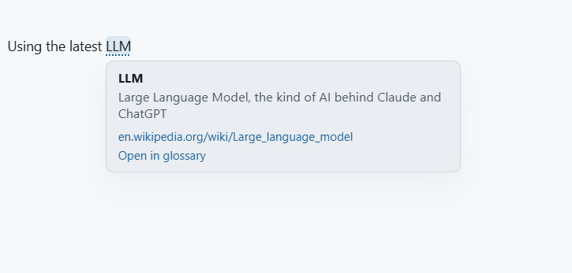
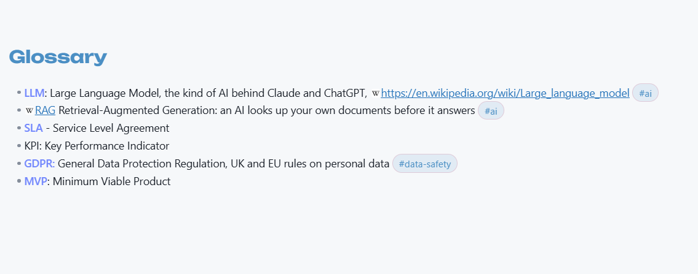

# Simple Glossary

An Obsidian plugin that reads your glossary note and marks those terms wherever they appear in your other notes. When you hover over a marked term, a tooltip explains it. It works on desktop only.



## The glossary note

Each entry is a list item. Any of these forms works:

```markdown
* **ADM**: Audio Definition Model, <https://github.com/IRT-Open-Source/libadm>
* **LLM**: Large Language Model #ai
* [RAG](https://en.wikipedia.org/wiki/Retrieval-augmented_generation) Retrieval-Augmented Generation #ai
- __BA__ - Business Analyst
- [[RAG]]: Retrieval augmented generation
1. KPI: Key performance indicator
```

Here is a glossary note in Reading view:



- The term is the bold text, the link text or the text before the colon.
- Everything after it is the explanation. Hashtags are removed from it, so you can still tag entries.
- The first web address in an entry, or the link on the term itself, appears in the tooltip as a clickable link.
- Headings, ordinary paragraphs, tasks, code blocks and frontmatter are ignored.
- If a term is listed twice, the first entry is used.
- The plugin rereads the glossary whenever you save it. If you rename or move the glossary note, the plugin follows it.

## In your notes

- Terms are marked in Reading view and while editing (Live Preview and Source mode).
- A term only matches as a whole word: `AR` matches "AR", "AR-based" and "(AR)", but not "ARM" or "CAR".
- Terms that contain symbols, such as `CI/CD`, match as written.
- Simple plurals count too, so `BA` also matches "BAs" and "BA's".
- A link whose text is a term, such as `[[SYMCA]]`, gets the tooltip every time; clicking it still follows the link.
- Nothing else is marked in code, links, tags, web addresses, headings, frontmatter, comments or maths, or in the glossary note itself.
- **Hover** over a marked term to see what it means. The tooltip stays open while your pointer is over it, so you can click its links.
- **Click** a term in Reading view to open the glossary at that entry. While editing, Ctrl-click it (Cmd-click on a Mac), or use *Open in glossary* in the tooltip.

## Adding a term

Run **Add a term to the glossary** from the command palette. To give it a hotkey, go to Settings → Hotkeys. A small window opens with a box for the term and a box for what it means:

- **Enter** saves and **Escape** cancels.
- If you had text selected in a note, it's filled in as the term.
- If the term is already in the glossary, the window tells you and doesn't save it.

The entry is added as `- TERM: what it means` to the glossary's list. That list is then sorted A–Z by the term alone, ignoring bold, links and upper or lower case. If your glossary has more than one list, for example under separate headings, each list is sorted on its own and the new term goes into the longest one. Lines indented under an entry move with it. Each list ends up with a single bullet style, and numbered lists are renumbered. If the glossary note doesn't exist yet, it is created.

## Settings

| Setting | What it does |
| --- | --- |
| Glossary note | The note to read terms from. Start typing to get a list of matching notes. |
| Reading view / While editing | Choose where terms are marked. |
| First use only | Mark only the first time each term appears in a note (on by default). |
| Match case | "AR" does not match "ar" (on by default). |
| Plurals | Also match "BAs" and "AR's" (on by default). |
| Look | Dotted underline, soft highlight, or both. |
| Hover delay | How long to hover before the tooltip appears. |

Commands: **Add a term to the glossary**, **Reload glossary** and **Open glossary note**.

## Privacy

Simple Glossary only reads your notes. It writes to just one: the glossary note, and only when you save a new term. It makes no network requests. The only other file it writes is its own settings file.

## Building

There are no dependencies and no bundler. `node tools/build.mjs` joins the files in `src/` into `dist/simple-glossary/`. To try a build, copy `main.js`, `manifest.json` and `styles.css` into `<vault>/.obsidian/plugins/simple-glossary/`, or open the `sample vault` folder in Obsidian. To put it on GitHub, run `tools/setup-repo.sh`. To release a version, run `tools/release.sh` (`--help` for each). See `CLAUDE.md` for the developer notes.
