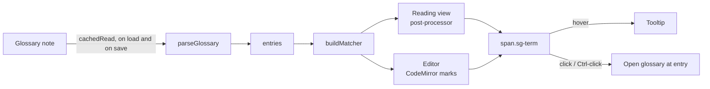

# Architecture

## Loading
`SimpleGlossaryPlugin.reload()` reads the glossary note with `vault.cachedRead`. `parseGlossary` turns it into entries, and `buildMatcher` makes one regular expression from all the terms, longest first. The expression only matches a term when there is no letter, digit or underscore either side of it, and it can include an optional plural ending. The plugin reloads when the glossary note is saved, created, deleted or renamed. A rename updates the saved path.

## Marking
Both views put the same `span.sg-term[data-sg-term]` around each match, so the tooltip and click handling don't need to know which view a term is in.

- **Reading view** (`reading.js`): a Markdown post-processor walks the text nodes of each rendered section. It skips code, links, headings, tags, maths, embeds and frontmatter. Reading view renders a note one section at a time, so with *First use only* on, `firstLines` works out from the whole note (`ctx.getSectionInfo`) which section holds each term's first use. Only that section marks the term.
- **Editor** (`editor.js`): a CodeMirror `ViewPlugin` decorates the whole document. It skips the ranges from `skipRanges` (frontmatter, code blocks, `$$` maths, headings, inline code, links, tags, URLs, comments and HTML). It rebuilds the marks when the document changes or when the plugin sends `sgRefresh`.

When the terms or a matching setting change, `refreshViews()` sends `sgRefresh` to every open editor and re-renders every Reading view.

## Links
`linkTerms` (editor) and the end of `sgMarkDom` (Reading view) mark links whose shown text, or wikilink target, is a term, such as `[[SYMCA]]` or `[[Other|AR]]`. They carry the extra class `sg-link`, are marked every time ("first use only" doesn't apply), and keep the link's own click: the click handlers ignore `.sg-link`.

## Tooltip and clicks
`watchDocument` adds listeners at document level, for the main window and each pop-out window: `mouseover`, `mouseout`, `mousedown` (capture), `click`, `keydown` (Esc) and `scroll`. Only one tooltip exists at a time. It is attached to `body`, positioned with `setCssStyles` below the term (or above it when there's no room) and built with DOM calls. It stays open while the pointer is over it. Web links open through `window.open`, which Obsidian passes to the system browser. *Open in glossary* goes to the entry's line using the `line` ephemeral state. If the glossary is already open in a tab, that tab is reused; otherwise it opens in a new tab.

## Settings
`data.json` holds `glossaryPath`, `inReading`, `inEditor`, `firstOnly`, `caseSensitive`, `plurals`, `look` and `hoverDelay`. *Look* is a class on `body` (`sg-look-underline`, `sg-look-highlight` or `sg-look-both`), so changing it needs no re-render. The glossary path field uses `AbstractInputSuggest` to list matching notes as you type.
